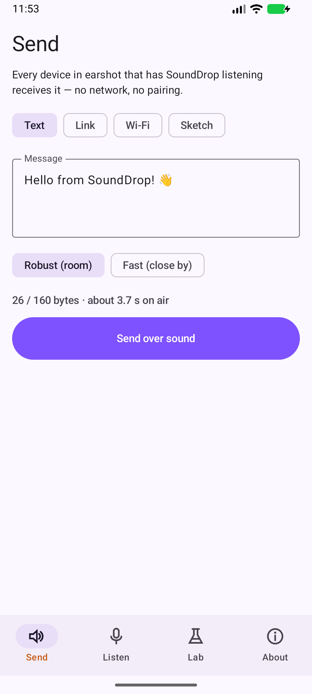
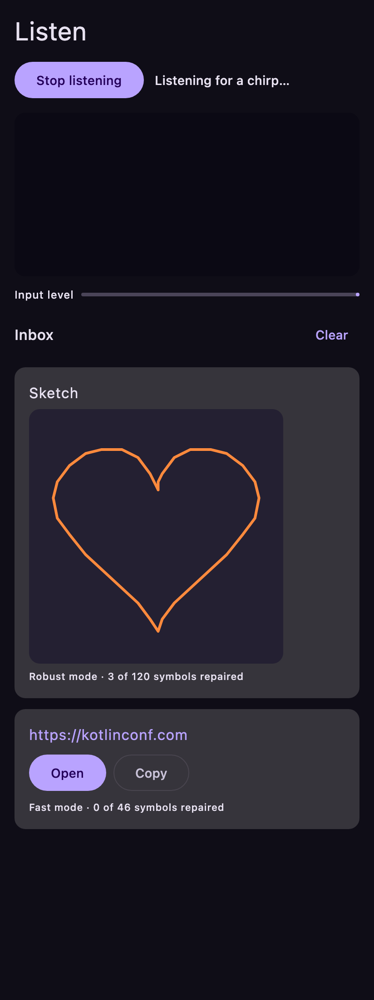
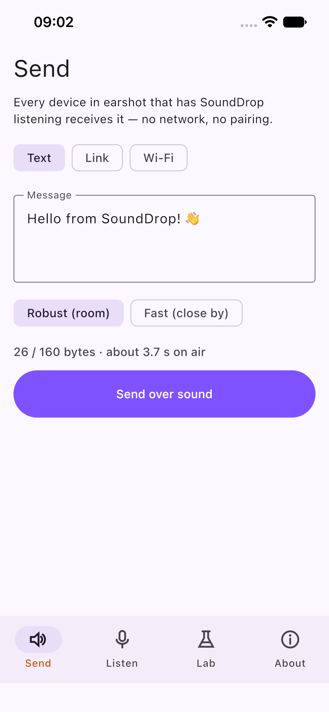
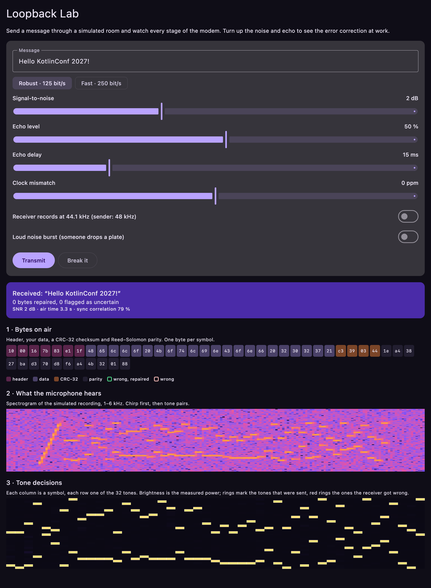

# SoundDrop

**Send text, links, Wi-Fi logins and drawings between any devices — over sound.**

SoundDrop is an acoustic modem written in pure Kotlin. A browser tab can chirp a link to an iPhone,
a laptop can pass a Wi-Fi password to an Android phone, and one drawing can reach every device in a
classroom at once. No network, no Bluetooth, no pairing, no accounts: just a speaker and a microphone.

The modem, the protocol, the error correction and the complete Compose Multiplatform UI are **shared
Kotlin code**. Each platform only contributes the few lines that move samples to the speaker and from
the microphone.

[](https://github.com/tim1105neumann/sounddrop/actions/workflows/ci.yml)
· License: MIT

<p>
  
  
  
</p>

<!-- TODO before submission: add the screencast link. -->

## Try it in 30 seconds

1. Open the web version at **https://tim1105neumann.github.io/sounddrop/** in Chrome or Firefox, or run the
   desktop app.
2. Open the **Lab** tab. It runs the real modem through a simulated room — no microphone needed.
   Press **Transmit**, then drag the noise and echo sliders and press **Break it**.
3. With two devices: press **Start listening** on one, type a message on the other and press
   **Send over sound**.

## Features

| | |
|---|---|
| **Send / Listen** | Text, links (open with one tap), Wi-Fi credentials (QR-code compatible format) and sketches. Live spectrogram, input meter and progress while receiving. |
| **Sketch broadcast** | Draw something; it is simplified and compressed to fit into one frame and replays stroke by stroke on every listening device in the room. |
| **Loopback Lab** | Sends a message through a software room with adjustable noise, echo, clock mismatch, 44.1/48 kHz mismatch and noise bursts, then shows every stage: bytes on air (header, data, CRC, parity), the spectrogram, every tone decision, and which bytes Reed–Solomon repaired. **Break it** lowers the SNR until decoding fails. |
| **Melodic mode** | Every byte becomes two plucked notes of a pentatonic scale, so a message plays as a little tune instead of beeps, and still decodes with the same error correction. |
| **Three profiles** | *Robust* (125 bit/s, survives echoey rooms), *Fast* (250 bit/s, for devices close together) and *Melodic* (50 bit/s, sounds like music). |
| **Adaptive UI** | Navigation bar on phones, navigation rail on wide screens, light and dark theme. |



## How it works

```
 bytes ──► CRC-32 ──► Reed–Solomon ──► 2 tones per byte ──► chirp + header + symbols ──► speaker
                                                                                           │ air
 bytes ◄── CRC check ◄── RS decode (errors + erasures) ◄── Goertzel tone detection ◄── matched filter ◄── mic
```

* **Preamble.** Every frame starts with a 0.2 s linear chirp (1.5 → 5 kHz). The receiver finds it with
  an FFT overlap-save matched filter, normalised by signal energy, which gives sample-accurate timing
  even in heavy noise (the end-to-end tests decode at 0 dB signal-to-noise ratio).
* **Modulation: dual-band 16-FSK.** Each symbol plays one of 16 tones in band A (1875–3281 Hz) and one of
  16 tones in band B (3469–4875 Hz) at the same time — 4 bits each, so **one symbol is exactly one
  byte**. Tones are Gray-coded and 93.75 Hz apart, a whole multiple of 1 / analysis window, so they are
  orthogonal. Oscillators are phase-continuous, so there are no clicks.
* **Guard interval.** The first third of every symbol is skipped by the receiver, so room echo of the
  previous symbol has time to fade.
* **Sample-rate independence.** All timing is defined in seconds and tones are measured with Goertzel
  filters at their exact frequencies, so a 44.1 kHz phone and a 48 kHz laptop understand each other
  without resampling.
* **Error correction.** The header (version, profile, type, length) is protected by RS(7,3). The payload
  gets a CRC-32 and about 50 % Reed–Solomon parity over GF(256) (Berlekamp–Massey, Chien search,
  Forney). Symbols whose two strongest tones are too close are passed to the decoder as *erasures*,
  which doubles the number of bytes it can repair.

Full specification: [docs/PROTOCOL.md](docs/PROTOCOL.md)

## Architecture

```
modem/            pure Kotlin Multiplatform library — commonMain only, explicit API, no dependencies
  dsp/            FFT, Goertzel, windows, chirp, spectrogram
  fec/            GF(256), Reed–Solomon (errors + erasures), CRC-32
  protocol/       profiles, tone plan, Gray code, frame header, frame layout
  tx/ rx/         modulator, preamble detector, symbol demodulator, streaming decoder
  channel/        channel simulator (noise, echo, drift, resampling, bursts)
  payload/        text / link / Wi-Fi / sketch codecs
composeApp/
  commonMain/     the whole UI and the TransceiverViewModel / LabViewModel
  jvmMain/        javax.sound audio engine + desktop entry point
  wasmJsMain/     Web Audio engine (AudioWorklet capture) + browser entry point
  iosMain/        AVAudioEngine audio engine + UIViewController entry point
  androidMain/    AudioRecord / AudioTrack audio engine
androidApp/       Android application: MainActivity and the microphone permission request
iosApp/           Xcode project hosting the Compose UI
```

The only platform abstraction is one small interface:

```kotlin
interface AudioEngine {
    suspend fun play(samples: FloatArray, sampleRate: Int)
    fun capture(): Flow<AudioChunk>
}
```

### Shared code

Generated with `./gradlew sharedCodeReport` (non-blank, non-comment lines):

| Source set | Lines of code |
|---|---:|
| modem/commonMain | 1386 |
| composeApp/commonMain | 1709 |
| composeApp/jvmMain | 105 |
| composeApp/wasmJsMain (incl. worklet JS) | 224 |
| composeApp/iosMain | 269 |
| composeApp/androidMain | 124 |
| androidApp (Activity) | 55 |
| iosApp (Swift) | 24 |

**79 % of the production code is shared** (3095 of 3896 lines) — every line of the modem and every screen. Tests
(`commonTest`) run unchanged on the JVM, Android, Kotlin/Wasm (Node.js and browser) and the iOS simulator.

## Running it

Requirements: JDK 17 or newer (21 recommended) on the `PATH`. The Gradle wrapper downloads everything
else. Clone the repository and run all commands from its root.

### Desktop (macOS, Windows, Linux)

```bash
./gradlew :composeApp:run
```

Native installers: `./gradlew :composeApp:packageDistributionForCurrentOS` (output in
`composeApp/build/compose/binaries`).

> **macOS microphone permission:** the permission prompt is shown for the app that launched Gradle
> (Terminal, iTerm or IntelliJ). If listening shows an error or the level meter stays flat, allow that
> app under *System Settings → Privacy & Security → Microphone* and restart it.

### Web browser

Hosted version: **https://tim1105neumann.github.io/sounddrop/** (deployed from `main` by
`.github/workflows/pages.yml`).

Run locally:

```bash
./gradlew :composeApp:wasmJsBrowserDevelopmentRun
```

This opens `http://localhost:8080`. **Use Chrome/Edge 119+ or Firefox 120+** (WebAssembly GC). Safari 18.2+
supports WebAssembly GC as well, but showed a blank page on one of our test Macs, so Chrome is recommended. Microphone access only works on `https://` or `localhost`. Click anywhere once so the
browser allows audio.

In the browser, Kotlin coroutines run on a single thread, so `Dispatchers.Default` shares the main thread
with the UI: decoding and the Lab's simulations run between frames instead of in parallel.

> If the page stays blank or shows "SoundDrop could not start", open it in Chrome or Firefox. The error
> page lists diagnostics (browser, WebAssembly support, failed downloads) that help to find the cause.

### iOS

Requirements: macOS with Xcode 16 or newer.

1. Open `iosApp/iosApp.xcodeproj` in Xcode.
2. Simulator: pick any iPhone simulator and press **Run**. The first build compiles the Kotlin framework
   and takes a few minutes. The simulator uses the Mac's microphone and speakers.
3. Real iPhone: create `iosApp/Configuration/Local.xcconfig` (git-ignored) containing
   `TEAM_ID=<your team ID>` — a free Apple ID "Personal Team" works — or pick the team under
   *Signing & Capabilities*. Connect the phone, enable *Developer Mode* on it if asked, and press **Run**.
   Allow microphone access when asked.

### Android

Requirements: Android 8.0 (API 26) or newer, or an emulator.

* **Install a prebuilt APK:** download `SoundDrop.apk` from the
  [latest release](https://github.com/tim1105neumann/sounddrop/releases/latest) and open it on the phone
  (allow installing from this source when asked).
* **Build and install with Gradle:** set up the Android SDK (for example with Android Studio) and tell
  Gradle where it is: set `ANDROID_HOME` (on macOS usually `~/Library/Android/sdk`) or put
  `sdk.dir=/path/to/sdk` into `local.properties`. Opening the project once in Android Studio creates that
  file for you. The desktop and web builds do not need the Android SDK. Connect a phone with USB
  debugging enabled or start an emulator, then run

  ```bash
  ./gradlew :androidApp:installDebug
  ```

* **Android Studio:** open the project folder and run the `androidApp` configuration.

Allow microphone access when you press *Start listening*. In the emulator, enable
*Extended controls → Microphone → Virtual microphone uses host audio input* to hear the computer's
microphone.

### Tests and code style

```bash
./gradlew allTests        # modem + app tests on JVM, Android (host), Wasm (Node + browser) and iOS simulator
./gradlew ktlintCheck     # Kotlin coding conventions (ktlint_official)
```

Optional extras:

* `SOUNDDROP_AIR_TEST=1 ./gradlew :composeApp:jvmTest --tests '*OverTheAirTest*'` plays a frame through
  the real speaker and decodes it from the real microphone (turn the volume up).
* `SOUNDDROP_SCREENSHOTS=/some/dir ./gradlew :composeApp:jvmTest` renders the screens to PNG headlessly.

## Tested on

* iPhone 17 Pro Max (iOS app) ↔ MacBook Pro (web app in Chrome), over the air.
* Android emulator (API 37), iOS simulator, desktop JVM and WebKit/Chromium for the UI.

## Tips for a good transmission

<!-- TODO: replace with measured distances after real-device testing. -->
* Turn the sender's volume up and use the built-in speaker.
* If a message is "heard but too damaged", move closer or switch to *Robust*.

## License

[MIT](LICENSE)
